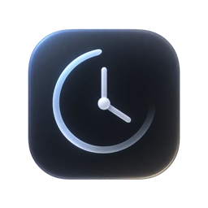
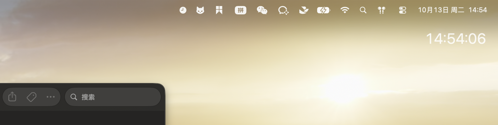
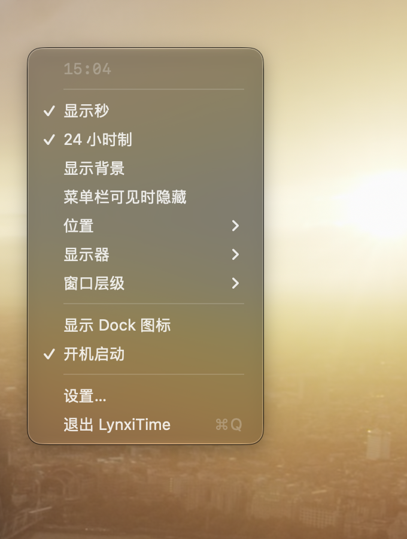
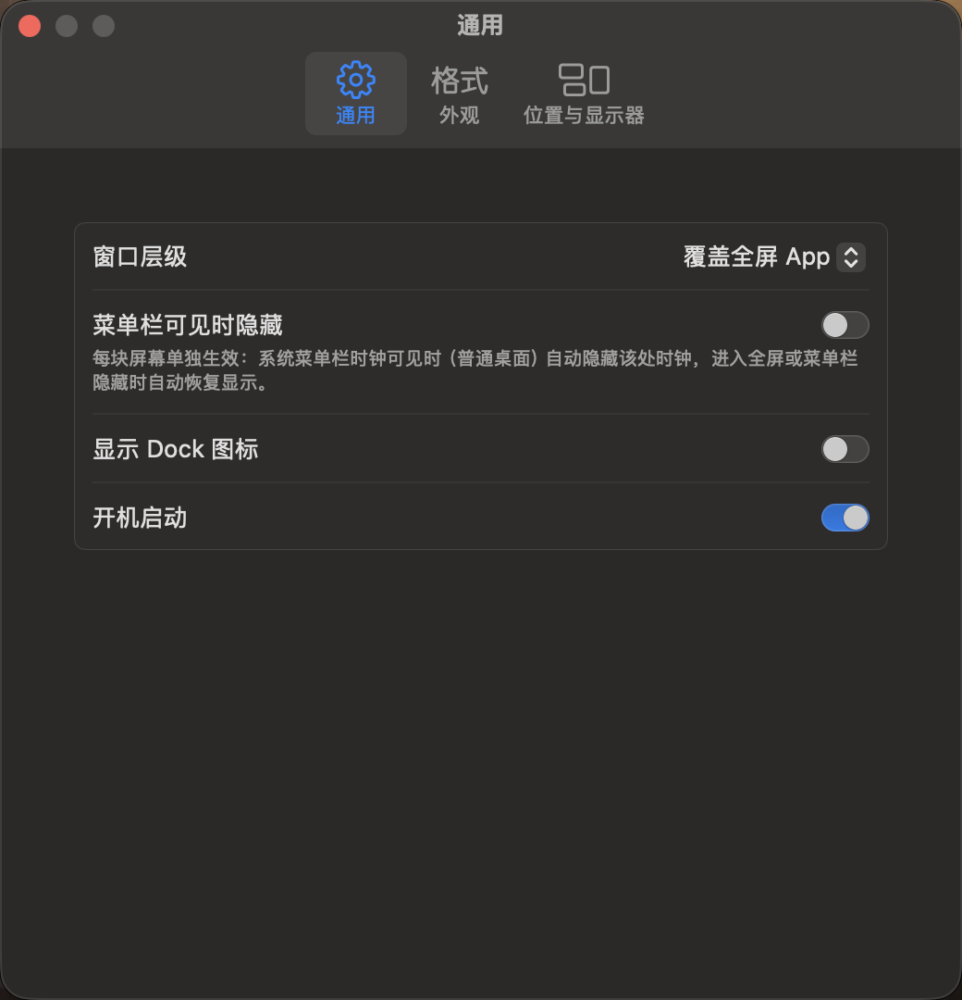
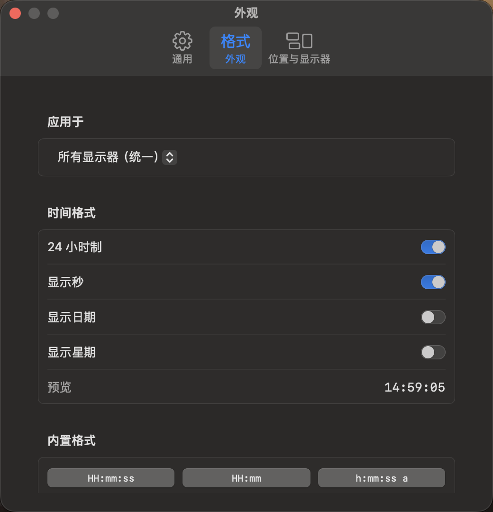
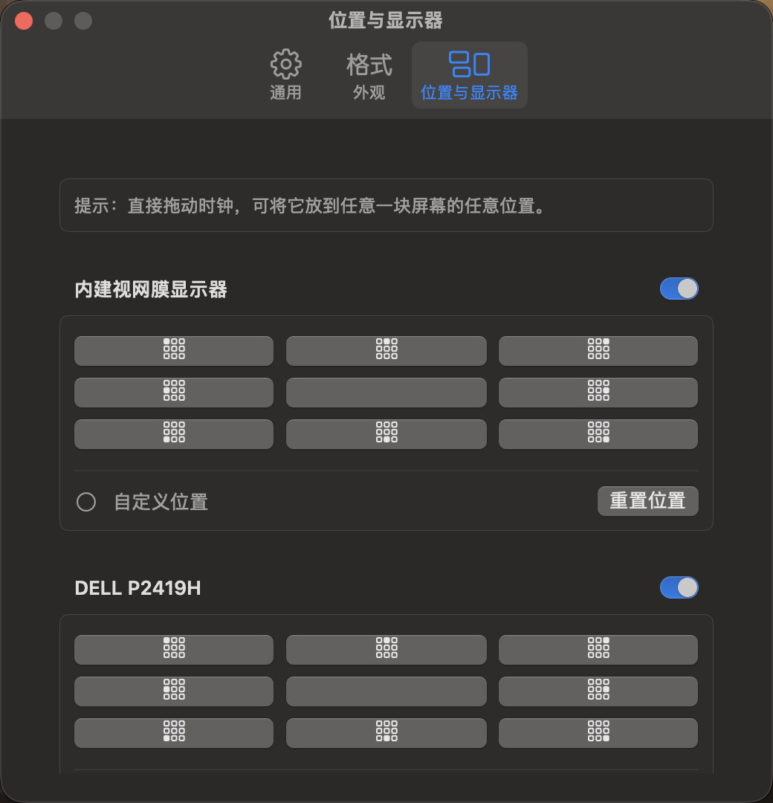

<div align="center">



# LynxiTime

**常驻屏幕角落的轻量 macOS 时钟 —— 全屏 App 与隐藏菜单栏下也始终可见，还能拖到任意位置。**

灵感来自 [Corner Time](https://cornertime.app)，并在其基础上增加了**自由拖拽定位**与**每屏独立外观**。


</div>

---



## ✨ 功能

- **始终可见** — 无边框透明非激活面板，覆盖全屏 App（`fullScreenAuxiliary` + 三档窗口层级：普通 / 悬浮 / 覆盖全屏 App）
- **跟随系统时钟自动隐藏** — 某块屏幕的系统菜单栏时钟可见时（普通桌面）自动隐藏该处时钟；进入全屏或菜单栏隐藏时自动恢复，逐屏独立判定，鼠标短暂划过顶边不闪烁，零系统权限
- **任意位置** — 按住时钟直接拖动到屏幕任何位置（窗口服务器原生 `performDrag`，跨不同缩放倍数的屏幕也顺滑不闪），松手即记住（按屏幕归一化存储，换分辨率不失位）
- **按应用记忆位置** — 菜单栏一个总开关：开启后，任何时候直接拖动时钟，松手即按「当前前台应用 + 全屏 / 普通窗口」自动记住落点；之后该应用在该屏前台时自动回到记忆位，同一应用的全屏与窗口位置分别记忆；切走或对应槽位无存档时用默认位置，可在设置中按应用清除，零系统权限
- **改格式不挪位** — 切换格式 / 字号时时钟围绕锚点中心伸缩，宽格式超出边缘才夹回，切回原格式精确回到原位
- **多显示器** — 每屏一个时钟，可单独开关；支持逐屏独立的格式、字体、字号、颜色与背景；跨屏拖拽自动迁移归属；屏幕热插拔自动对账
- **时间格式** — 24 小时制、秒、日期、星期开关；9 个内置格式一键切换；支持自定义 DateFormatter 格式串
- **皮肤** — 文字 / 背景各 16 种内置颜色，背景透明度与圆角可调
- **字体** — SF Pro / SF Mono / SF Rounded，或本地安装的任意自定义字体
- **其他** — 菜单栏常驻（可显示 Dock 图标）、`SMAppService` 开机启动、单 Timer 低功耗、英文 / 简体中文双语跟随系统

## 📸 界面

| 菜单栏菜单 | 通用设置 |
|:---:|:---:|
|  |  |
| **外观（支持逐屏独立）** | **位置与显示器** |
|  |  |

## 🚀 构建与运行

无需完整 Xcode，只需 Swift 命令行工具（`xcode-select --install`）：

```bash
# Debug
swift build

# Release：生成 universal2 的 dist/LynxiTime.app（ad-hoc 签名）
bash scripts/make_app.sh

open dist/LynxiTime.app
```

如需放到「应用程序」：

```bash
cp -R dist/LynxiTime.app /Applications/
```

> 应用图标源文件为 `Assets/AppIconSource.png`，修改后运行 `bash scripts/make_icon.sh` 可重新生成 `Assets/AppIcon.icns`。

## 🕹️ 使用

- 启动后菜单栏出现时钟图标，每块屏幕右上角出现时钟。
- **拖动**：按住时钟拖到任意位置，松手 0.25 秒后记住位置。
- **菜单栏菜单**：快捷切换秒 / 24 小时制 / 背景 / 自动隐藏，九宫格位置，显示器开关，窗口层级，以及设置入口。
- **设置窗口**：通用 / 外观 / 位置与显示器三页。外观页顶部「应用于」可选择某块屏幕并开启「使用独立外观」；菜单栏快捷开关始终只改统一外观。
- **按应用记忆位置**：菜单栏菜单打开「按应用记忆位置」总开关（默认开）→ 前台停在某应用时直接拖动时钟，松手即自动为该应用存档；同一应用全屏空间与普通窗口分别记一套；切应用或切全屏状态自动恢复，槽位无存档或总开关关闭时走每屏默认位置；设置 → 位置与显示器中可查看（全屏 / 窗口分别列）或清除。

### 清除偏好

```bash
# .app 运行的偏好域
defaults delete com.lynxi.LynxiTime
```

## 🧱 工程结构

```
Sources/LynxiTime/
├── LynxiTimeApp.swift        # @main：MenuBarExtra(.menu) + Settings
├── AppSettings.swift         # 全部设置（UserDefaults 持久化）+ ClockAppearance
├── TimeTicker.swift          # 对齐整秒的共享时钟
├── ClockFormat.swift         # 开关组合 -> DateFormatter；内置格式预设；自定义串透传
├── SystemClockVisibility.swift  # CGWindowList 检测各屏菜单栏可见性 / 前台 App 铺满屏集合
├── ActiveApp.swift           # 前台应用 + 活动窗口所在屏 + 是否铺满（全屏），零权限
├── DisplayTheme.swift        # 单屏外观解析（全局 vs 独立快照）+ 防抖变更回调
├── ClockPanel.swift          # NSPanel：透明、非激活、全屏辅助层
├── ClockHostingView.swift    # NSHostingView：performDrag 原生拖拽
├── ClockView.swift           # SwiftUI 时钟渲染
├── ClockManager.swift        # 每屏一个面板：热插拔、跨屏迁移、显隐、尺寸/位置同步
├── PositionMath.swift        # 九宫格 / 归一化自由位置换算
├── MenuBarContent.swift      # 菜单栏菜单
├── SettingsView.swift        # 设置窗口
├── LaunchAtLogin.swift       # SMAppService 封装
└── Resources/{en,zh-Hans}.lproj/Localizable.strings
Assets/                       # 图标源文件 + AppIcon.icns
scripts/make_app.sh           # release 构建 + 组装 .app + ad-hoc 签名
scripts/make_icon.sh          # 由 AppIconSource.png 重新生成 .icns
```

## 🔧 实现备忘

- 面板必须以**目标屏最终坐标** `defer: true` 创建，SwiftUI 内容在 init 内挂载完成后才能 `orderFront`，
  否则在 @2x / @1x 混合缩放下会内容空白或缩放错误。
- contentView 从 init 第一刻起就要使用该屏**真实的 DisplayTheme**（经 `ClockPanel.pendingTheme`
  在 super.init 前传入）：占位主题会在 init 期间缩窗，之后换 rootView 会围绕错误锚点自 resize。
- 尺寸重排由各屏 `DisplayTheme` 解析后的 `$style`（120ms 防抖）驱动，不能让管理器直接订阅 AppSettings
  （`receive(on:)` 晚一个 RunLoop 才更新，提前测量会读到旧尺寸并消耗掉唯一一次触发）。
- 预设位永远经 PositionMath 按新尺寸重新贴边；只有自由位围绕记录的锚点中心伸缩。
- 「系统菜单栏时钟可见 ⇔ 隐藏本时钟」为双信号判定，数据源均为 CGWindowList，零权限：
  ① 各屏存在 Window Server 的 `Menubar` 窗口（layer 24、宽度≈屏宽、贴该屏顶边）；
  ② 前台 App 没有 layer-0 窗口铺满该屏（宽≈屏宽、上沿进入菜单栏条带、底到屏幕底；
  桌面最大化窗口因给 Dock 留位而不满足）。macOS 26 起全屏空间里 Menubar 窗口不再离开
  onScreen 列表（只是视觉滑走），单看信号 ① 会失效，必须两个信号合取。全屏下鼠标贴顶
  唤出菜单栏时按「暂时可见」处理——鼠标必须落在该屏自身顶边 5pt 条带内（含 x 范围），
  否则鼠标在上方/相邻显示器时会误判。0.1s 轮询 + 前台 App / 空间切换通知双驱动，
  隐藏 0.25s 防抖，查询失败 fail-open（宁可常显）。隐藏只 `orderOut`，恢复时按原锚点直接回来。
- 程序化移动窗口通过 `isApplyingFrame` + 期望 frame 字典过滤 didMove；跨屏拖拽送回原占面板期间
  用 migrationGuard 短时屏蔽其 didMove，避免 intrinsic 自 resize 被误判为用户拖拽。
- 按应用记忆位置（v3 逐屏模型）：一次遍历前台进程的在屏 layer-0 窗口，同时得出两个逐屏集合——
  窗口中心命中的屏幕（windowDisplays = 该 App 在这块屏有窗口）与窗口铺满的屏幕
  （coveredDisplays = 全屏空间）；应用窗口同时分布在多块屏时各屏独立恢复，不再只认首个窗口。
  存储 `appPositions[displayID][bundleID] = {fullscreen?, windowed?}`，全屏槽以屏幕完整 frame
  归一化（全屏空间可放到真正顶角；桌面 visibleFrame 在全屏 Space 里仍是桌面几何，用它会产生
  十几 pt 偏移），窗口槽 / 默认位以 visibleFrame 归一化（避开菜单栏 / Dock）。归一化时把中心
  先夹到 origin() 实际可达的边距范围内，保证「落点 → 恢复」像素级往返、无累积漂移；极端贴边落点
  首次恢复最多收进 8pt 安全边距。落位只认用户拖拽：didMove 先过 migrationGuard 再要求鼠标左键
  按住期间，防止程序化移动误写存档。本 App 自己的菜单/设置在前台时保留切换前的应用上下文；
  0.5s 轮询 + 通知双驱动，全屏切换、漏通知都能收敛；每屏缓存当前生效槽位 id（`bundleID#fs/win`），
  只在槽位真的变化时移动；总开关切换走强制重摆（缓存与目标同为 nil 时去重会跳过，导致关开关不回位）。
  注意：AppKit 对 accessory 进程 vended 的副屏 visibleFrame 在多 Space / 沉浸式全屏下可能与普通
  进程不同（如顶部 30pt 菜单栏预留），存档与恢复在同一进程内自洽，落点玻璃坐标往返一致。
- 订阅 `@Published` 并在闭包里读取当前值立即生效的，必须 `receive(on: RunLoop.main)`
  （`@Published` 在 willSet 阶段发送，同步闭包读到旧值）。
- 菜单栏菜单头部的时钟只在整分钟发布：打开的菜单里每秒改标题会导致 AppKit 重建菜单项（悬停项上下飘）。

## 🙏 致谢

- [Corner Time](https://cornertime.app) — 产品灵感来源。

## 📄 License

[MIT](LICENSE)
